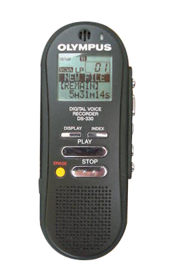

# ds330tool — Olympus DS-330 on Linux

`ds330tool` is a command-line tool for working with the Olympus DS-330 
digital voice recorder (c. 2002) over USB. It allows downloading and clock
sync.



The DS-330's USB protocol is proprietary; this tool was built by
reverse-engineering the wire traffic of the original Windows-only _DSS Player_
software. The full protocol is documented in 
[docs/DS-330_PROTOCOL.md](docs/DS-330_PROTOCOL.md).
Corrections and further technical information are always appreciated.

## Commands

- `info` — device identity, folders, file table, recording dates
- `download` — download recordings as `.dss` (byte-identical to what the
  Windows player produces), optionally converting to `.wav` via ffmpeg
- `settime` — set the recorder's clock from the computer clock
- `reset` — recover a wedged device without unplugging

## Requirements

- Linux with libusb-1.0
- Python 3.8+ (`libusb` loaded via `ctypes`)
- `ffmpeg` (optional, for `--wav` conversion of the DSS recordings)

## Installation

1. Install the udev rule so the device is usable without root:

   ```sh
   sudo cp udev/99-ds330.rules /etc/udev/rules.d/
   sudo udevadm control --reload && sudo udevadm trigger
   ```
   
   This is technically optional, but highly recommended.

2. Plug in the recorder (or replug it after installing the rule), then
   run from the checkout:

   ```sh
   python3 src/ds330tool.py info
   ```

## Usage

```sh
python3 src/ds330tool.py info                  # device, folders, file table
python3 src/ds330tool.py download              # first recording, folder A
python3 src/ds330tool.py download -f E -i 2 --wav  # RANDOM folder, file 2, convert
python3 src/ds330tool.py settime               # sync recorder clock to PC
python3 src/ds330tool.py reset                 # recover wedged device
```

Downloads are written as `<name>.dss` (override with `--out FILE`);
`--wav` produces a `.wav` next to it via ffmpeg (DSS-SP codec,
11.025 kHz mono).

## Tips and troubleshooting

- **`claim_interface: -3` / permission errors** — the udev rule is not
  active; install it and replug the recorder.
- **"device rejected ..." errors** — the recorder sometimes rejects valid
  commands out of a stale session state; run `reset` and retry.
- Set the clock (`settime`) before making new recordings — the DS-330
  stamps each file with its clock at record time, and an unset clock
  defaults to 2002-01-01.
- Recordings can be converted with ffmpeg directly:
  `ffmpeg -i file.dss file.mp3`.

## Repository layout

| Path | What |
|---|---|
| `src/ds330tool.py` | The tool (transport / declarative protocol / executor layers) |
| `tests/` | Pytest suite, built on fixtures captured from a live device |
| `docs/DS-330_PROTOCOL.md` | Wire-protocol reference |
| `docs/CURRENT_STATE.md` | Live project state, open questions |
| `docs/DS-330_NOTES.md` | Background survey and project log |
| `src/*.c`, `src/*.py` (other) | Probe/dump tools used during reverse-engineering; kept for reference |
| `data/dsstimescript` | Third-party GPLv2 DSS filename helper (Alexey Fisher, 2006) |
| `udev/` | udev rule for device access |

## Development

Run the test suite (no hardware needed — the USB layer is exercised via a
scripted fake):

```sh
python3 -m pytest tests/
```

The `tests/data/` fixtures were captured from a real DS-330 (raw download
stream, file-info object, reference DSS). When changing the stream parser,
`test_extract_dss_real_stream_roundtrip` will catch regressions against
the captured data.

## License

GPL-3.0 — see [LICENSE](LICENSE).
